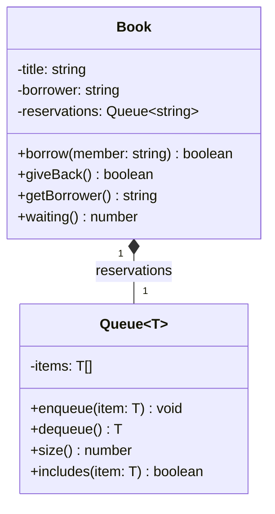

# OOP Lab 4 — Generics in Practice
## Predictions and Answers — Parts 1–5

---

## Part 1 — The Problem

### Prediction 1

No line is underlined in red because the `find()` method returns
`any`. TypeScript does not check whether the returned value
has the requested methods.

When the program runs, it prints `Awa` and then throws a
TypeError because `Member` does not have a `describe()` method.

### Question 1

The `any` version sacrifices type safety. TypeScript can no
longer verify whether the stored objects provide the required
methods, allowing invalid operations to reach runtime.

The statement `memberList.add(42)` would not be caught by
TypeScript because `any` accepts every type. However, it
would cause a runtime error when the program attempts to
call `getId()` on the number.

---

## Part 2 — A Generic Catalog

### Question 2

Error message:

Property 'getId' does not exist on type 'T'.

TypeScript refuses to call `getId()` because an unconstrained
generic type `T` can represent any type, including types that
do not have a `getId()` method.

Adding `T extends HasId` guarantees that every accepted
type provides a `getId()` method returning a string.

### Question 3

TypeScript uses structural typing. A class satisfies an
interface when its structure matches the interface's
requirements, even without explicitly implementing it.

Both `Book` and `Member` have a public `getId()` method
returning a string, so they satisfy `HasId`.

### Question 4

(a) `books.add(new Member("M-02", "Moussa"))`

TypeScript prevents adding a Member to a Catalog<Book>
because Member does not provide all the members required
by Book, particularly `describe()`.

The type parameter in `Catalog<Book>` makes this possible.

(b) `new Catalog<number>()`

TypeScript prevents using number as the catalog's item type
because numbers do not satisfy the HasId constraint.

The constraint `T extends HasId` makes this possible.

(c) `console.log(found.describe())`

TypeScript prevents calling `describe()` directly because
`find()` can return undefined if the requested book is
not found.

The return type `T | undefined` and strict null checking
make this possible.

### Prediction 2

No test lines need to change after replacing the internal
array with a Map.

The public methods still accept the same arguments and
return the same types and results.

Checkpoint 1 produces the same output.

### Question 5

No test line changed because the internal storage is
encapsulated inside the Catalog class.

The public interface remains unchanged, so callers do
not need to know whether the catalog uses an array or
a Map internally.

### Question 6

If all() directly returned the internal array, a caller
could bypass add() and insert duplicate IDs:

books.all().push(new Book("B-001", "Duplicate Book"));

This would break the no-duplicate-IDs rule because the
caller would modify the original internal array without
passing through the duplicate check in add().

Returning a new array prevents this because changes to
the returned array do not modify the catalog's internal
collection.

---

## Part 3 — Generic or Not?

### Question 7

Error message:

Property 'describe' does not exist on type 'Borrowable'.

The function returns Borrowable | undefined, so TypeScript
only guarantees methods defined by the Borrowable interface.

Although the actual returned object is a Dvd, the interface
only declares lateFee(). It does not declare describe().

### Prediction 3

The inferred type of worstOverall is:

Book | Laptop | undefined

TypeScript infers a union because the input array contains
both a Book and a Laptop.

Calling worstOverall.describe() is rejected because
worstOverall might be undefined, and Laptop does not
provide a describe() method.

After checking that the value is defined, calling
lateFee(3) works because both Book and Laptop implement
the Borrowable interface.

The output is 8000.

### Question 8

A generic is worth using when the function returns a value
whose type depends on the types of its input arguments.

totalFees() only returns a number, regardless of the
specific Borrowable objects supplied, so it does not
need a generic type parameter.

mostCostly() returns one of the original input objects.
A generic preserves the specific input type in its return
type instead of reducing it to Borrowable.

For mixed inputs such as Book and Laptop, TypeScript
infers the union Book | Laptop | undefined.

---

## Part 4 — A Generic Class as a Part

### Question 9

The type parameter T is chosen when the Book class
declares its reservations field as Queue<string>.

Here, T is string because the queue stores member names.

Book uses composition because a Book has a queue of
reservations; it is not itself a queue.

If Book extended Queue<string>, inherited public methods
would let a caller bypass the reservation rules:

book.enqueue("Moussa");

This would allow a caller to manipulate the waiting queue
without using the borrow() method.

### Question 10

The first time borrow("Moussa") returned false, Moussa
was added to the reservation queue because Awa already
had the book.

The second time it returned false, Moussa was already
waiting, so nothing changed.

A boolean return value cannot distinguish between a
failed immediate borrow that successfully created a
reservation and a rejected duplicate request.

Both situations return false even though their effects
are different.

### Task 3 — Mermaid Class Diagram

Note: The diagram abbreviates the nullable return types;
in the TypeScript implementation, getBorrower() returns
string | undefined and dequeue() returns T | undefined.

### Question 11

I chose composition because the Book class owns and
manages a Queue<string> as one of its internal components.

Each Book contains exactly one reservation queue, and
that queue manages the waiting members for that book.

The queue is an implementation detail of Book rather
than a separate behavior that Book should inherit.

Composition also prevents callers from bypassing the
borrowing rules through inherited queue operations.

---

## Part 5 — What Generics Cannot Do

### Prediction 4

Error message:

'T' only refers to a type, but is being used as a value here.

The program stops with a runtime ReferenceError because
T is not available as a constructor or value at runtime.

The expression `value instanceof T` is invalid because
generic type parameters exist only during type checking.

### Prediction 5

The first line prints:

Things Fall Apart

The second line prints:

NaN

The JSON object contains a valid title but does not
contain the copies property.

Therefore, books[0].copies is undefined, and adding
1 produces NaN.

### Question 12

TypeScript types are erased at runtime.

Generic type parameters and type annotations do not
exist when the JavaScript code executes.

This explains why `instanceof T` cannot work and why
`parseJson<BookData[]>()` cannot guarantee that the
parsed JSON actually has the required properties.

Data from external sources must be validated at runtime,
at the boundary where it enters the application, before
the program uses it as a trusted typed value.

---

## Checkpoints

Checkpoint 1 — Catalog:
true
true
false
2 1
So Long a Letter [B-002]
Awa
undefined

Checkpoint 2 — Total fees:
9050
0

Part 3 — Most costly:
Atlantics
8000

Checkpoint 3 — Reservations:
true false false
Awa 2
false 2
true Moussa 1
true true false undefined

Part 5 — Runtime limitations:
Things Fall Apart
NaN

---

## Part 6 — Homework

To be completed separately.
